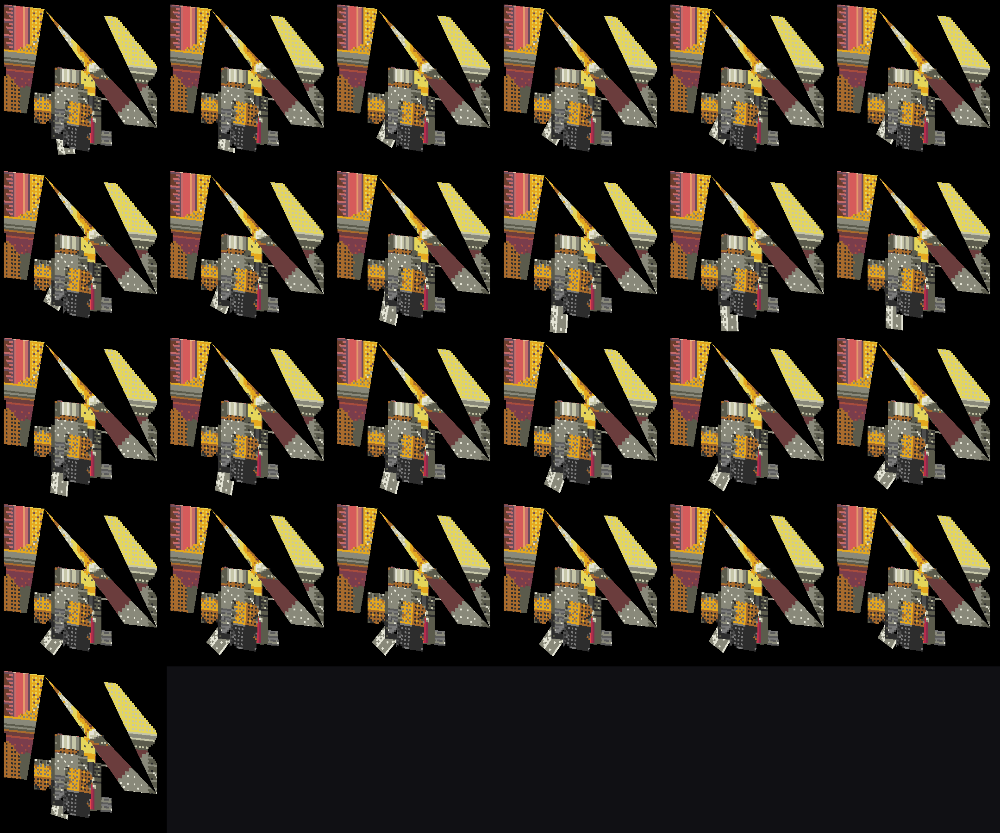
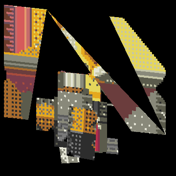

# 动画系统逆向 + 渲染验证

> 目标：不满足于"读出数据结构"，而是把**贴图 + 网格 + 骨骼曲线 + 播放器时序**四件事串起来，
> 用自研软件蒙皮渲染器把动画真正画出来，与二进制反汇编对照验证。
>
> 本文所有播放器公式均来自 `libil2cpp.so`（已 dump 的 `libil2cpp_unpacked.so`）ARM64 反汇编；
> 所有渲染结果均由 `_re_work/render_anim2.py` 生成，产物在 `docs/anim/`。

---

## 1. 资源全景

热更新目录 `/sdcard/Android/data/com.nhnent.SKQUEST/files/Assets/` 共 **3546 个 AssetBundle**（明文 `UnityFS`，无加密）。

按前缀统计（前 15）：

| 前缀 | 数量 | 含义 |
|---|---|---|
| `cutscene` | 933 | 剧情演出（模型/相机/动画） |
| `skillprefabs` | 779 | 技能投射物/特效 prefab |
| `portrait` | 664 | 英雄立绘 |
| `pc` | 236 | 玩家角色贴图/配件/网格 |
| `spritecollection` | 143 | tk2d 精灵图集（UI/特效） |
| `fbx` | 77 | **骨骼模型 + 动画** |
| `skin` | 75 | 怪物皮肤贴图（稀疏，6 KB 级） |
| `animationclip` | 7 | 非骨骼 AnimationClip（UI/节奏） |
| `cutscenelegacyanimclip` | 18 | 剧情 legacy 动画 |

动画资源分三类，语义完全不同，**不能混为一谈**：

| 类别 | 载体 | 数量 | 用途 |
|---|---|---|---|
| **骨骼动画** | `fbx_*` 内的 `AnimationClip` | `fbx_pc` 159 个 / `fbx_pc@sword` **743 个** | 角色/怪物招式、待机、死亡 |
| **非骨骼 AnimationClip** | `animationclip_*` 内的 `AnimationClip` | **99 个** | UI、钓鱼、节奏游戏、大厅 |
| **技能 prefab 内置 clip** | `skillprefabs_*` | 每包 0~5 个 | 特效网格动画（`fx_skill_hit` 等） |

---

## 2. 运行时播放器架构（二进制证据）

### 2.1 类层次

| 类 | TypeDefIndex | 方法数 | 角色 |
|---|---|---|---|
| `CQAnimation` | 4580 | 23 | **抽象基类** |
| `CQUnityAnimation` | 4583 | 13→16 | 真实实现（驱动 `UnityEngine.AnimationState`） |
| `CQSpineAnimation` | 4652 | 13 | Spine 实现 |
| `CQAnimationManager` | 4582 | 8 | 全局帧驱动 / 增删管理 |

**陷阱**：`CQAnimation` 的 `AdvanceFixedTime` / `InterpolateTime` / `SampleAnimation` 在反汇编里都是**单条 `ret` 的虚方法桩**。
按名字直查会以为"没有实现"，真实逻辑全在子类 `CQUnityAnimation`。

### 2.2 `CQAnimationManager`

| 方法 | 地址(modoff) |
|---|---|
| `AdvanceFixedTime` | `0x2EF41A4` |
| `Add` | `0x2EF4080` |
| `ClearAll` | `0x2EF4108` |
| `get_UniqueID` | `0x2EF402C` |

`AdvanceFixedTime` 是**双列表遍历**：`[x19+0x20]` 是待添加列表、`[x19+0x28]` 是待移除列表，
对每个存活元素调 `0x334b3c0` / `0x417af30` 推进。这样避免在遍历中直接增删。

`AdvanceFixedTime` 的 6 个调用点：
`FixedUpdate` @ `0x2642A3C` / `0x2E31A64` / `0x2F29804` / `0x3003098`，
`AdvanceFixedTimeForCommon` @ `0x278DD38` / `0x2DE9A18`。

`ClearAll` 调用点：`AllPurge` @ `0x278C2D8`、`Reset` @ `0x278C864`。

`CQSpineAnimation.Play` @ `0x2F1080C` 是**唯一**同时调用 `get_UniqueID` 与 `Add` 的地方，
即"Spine 动画注册进管理器"的唯一入口。

### 2.3 `CQUnityAnimation.AdvanceFixedTime` @ `0x2EF5460`

`CQUnityAnimation` 字段：

| 偏移 | 类型 | 含义 |
|---|---|---|
| `+0x28` | int | 当前 AnimationState 索引 |
| `+0x40` | float | **当前播放时间** |
| `+0x44` | bool | 启用标志 |
| `+0x48` | float | 速度倍率 |
| `+0x58` | list | AnimationState 表 |

反汇编要点：

```asm
ldr  x0,[x19,#0x58]        ; AnimationState 表
ldr  x1,[x19,#0x28]        ; 索引
bl   get_Item              ; -> AnimationState
bl   0x4c8834c             ; get_speed
fmul s0, s0, [x19,#0x48]   ; speed * 速度倍率
fmul s8, s0, s8            ; dt' = dt * speed * scale
ldr  s0, [x19,#0x40]       ; 当前时间
fadd s0, s0, s8
str  s0, [x19,#0x40]       ; time += dt'
```

回绕：`get_wrapMode == 2`（Loop）时若 `time > get_length` 则 `fsub` 回绕到区间内。

**公式（已用渲染复现验证）**：

```
currentTime += clipSpeed × speedScale × deltaTime
if wrapMode == Loop and currentTime > clip.length:
    currentTime -= clip.length
```

### 2.4 `CQUnityAnimation.InterpolateTime` @ `0x2EF5760`

这是"非定步长"路径，供插值采样用：

```asm
bl get_speed               ; s = 动画片段速度
bl get_time / get_deltaTime
fsub s2, s9, s10           ; deltaTime
fmul s0, s12, #24.0        ; 帧号 = floor(time * 24.0)   （frintp 取整）
fmul s0, s8, s2            ; speed * deltaTime
fmul s0, s13, s0           ; * [+0x48] 速度倍率
fadd s0, s12, s0           ; 新时间
fmul s1, s1, s11           ; 帧号 * SampleRate
ldr  s2, [x8, #0xe14]      ; 上限
fcsel s0, s0, s1, mi       ; 取较小者
b    0x4c89170             ; AnimationState.set_time
```

**结论**：
- 采样帧率常量是 **24.0**（不是 30）；`frame = floor(time × 24)`
- 与片段自身的 `m_SampleRate`（多数 24，部分 30/60）相乘后取小，用于把时间对齐到采样点
- 与 `AdvanceFixedTime` 共用同一套 `speed × 倍率` 缩放

### 2.5 与技能时序的关系

技能飞行/多段触发的时序**不走动画播放器**，而是 `SkillCodeHandler.AdvanceTime` @ `0x29D8190`：

```
elapsed   += dt * GetMotionSpeed()      ; [+0x80]
fireTimer += dt                         ; [+0xd0]
if fireTimer >= GetScaledFireDelay():   ; SkillDefinition+0x2C0 FireDelay
    fireTimer -= delay
    Fire()
```

`GetMotionSpeed` @ `0x29D80CC` 返回施法者 `get_MotionSpeed` → **技能计时随施法者移动速度缩放**。
`GetScaledFireDelay` @ `0x29D82FC` 在"首次发射 + `SkillDefinition+0x2B0` bit0 置位"时返回 **0**（立即发射）。

> 所以"动画快慢"与"技能触发快慢"是两条独立管线，都乘了各自的 speed，但时间基准各自维护。

---

## 3. 骨骼动画资源结构（`fbx_*`）

### 3.1 `fbx_pc@sword`（剑职业角色）

| 项 | 值 |
|---|---|
| 大小 | 4,881,466 B |
| 对象 | 874（AnimationClip 743 / Transform 58 / GameObject 58 / SkinnedMeshRenderer 2 / Mesh 1 / Animation 2） |
| 骨骼根 | `PC@SWORD_GO`、`PC@SWORD`（同名双根，路径需做前缀归一） |
| 骨骼数 | 17（`SkinnedMeshRenderer.m_Bones`） |
| 网格 | `ChaMesh_Resize` 73 顶点 / 37 三角形 / bindpose 17 |

`fbx_pc`（通用角色）：

| 项 | 值 |
|---|---|
| 大小 | 977,277 B |
| 对象 | 1088（AnimationClip 159 / Transform 435 / GameObject 435 / SkinnedMeshRenderer 15 / Mesh 9） |
| 蒙皮渲染器 | `ChaMesh_Resize`(17 骨) ×5、`polySurface6`(20 骨) ×2、`polySurface1`(24 骨) ×2 |
| 网格规模 | `ChaMesh_Resize` 73v/37t、`polySurface6` 91v/49t、`polySurface1` 89v/49t；另有 4 个网格顶点数据被剥离（`m_VertexCount==0`） |

**重要认知**：这是**极低模**（73~91 顶点）。角色不是高模，而是"多面片分层拼装"，每片面片映射图集的一块。

### 3.2 顶点流布局（关键格式细节）

Unity 的 `Mesh.m_VertexData` 把属性拆成最多 4 条 stream，文件里是**拼接**的裸字节。
没有 `m_StreamData`（离线内嵌），必须自己算偏移：

- 每条 stream 的 `stride` = 该 stream 内所有通道的 `max(offset + 分量字节 × 维度)`
- 各 stream 起点 **按 16 字节对齐**递增

`fbx_pc@sword / ChaMesh_Resize`（73 顶点，dataSize 1764）实测：

| stream | 通道 | 通道属性 | stride | 起始偏移 |
|---|---|---|---|---|
| 0 | ch0 Vertex / ch1 Normal | Float32×3 | 12 | **0** |
| 1 | ch4 UV0 | Float32×2 | 8 | **880** |
| 2 | ch13 BlendIndices | **UInt32×1** | 4 | **1472** |

（880 = ceil16(12×73) = 876→880；1472 = ceil16(880+8×73) = 1464→1472）

`fbx_pc / ChaMesh_Resize`（73 顶点，dataSize 2644）是带 Normal 的变体：strides `{0:24, 1:8, 2:4}`，starts `{0:0, 1:1760, 2:2352}`。

顶点属性索引约定：`0=Vertex, 1=Normal, 2=Tangent, 3=Color, 4=UV0, 12=BlendWeight, 13=BlendIndices`。
Unity 顶点格式枚举：`0=Float32, 1=Float16, 2=UNorm8, 3=SNorm8, 4=UNorm16, 5=SNorm16, 6=UInt8, 7=SInt8, 8=UInt16, 9=SInt16, 10=UInt32, 11=SInt32`。

### 3.3 蒙皮方式：刚性单骨骼

决定性证据：
- `BlendIndices` 的 `dimension = 1`、`format = 10 (UInt32)` → **每个顶点只有 1 个骨骼索引**
- `BlendWeight` 通道 `dimension = 0` → **不存在权重通道**
- `m_CompressedMesh` 的 `m_Weights.m_NumItems = 0`（未走压缩网格路径）

因此蒙皮是**刚性绑定**，权重恒为 1：

```
v' = (boneWorld[b] × bindPose[b]) × v        // b = BlendIndices[v]，无混合
```

这大幅降低了还原成本——不需要处理 4 骨骼线性混合（LBS）的权重归一。

### 3.4 bindPose 格式

`Mesh.m_BindPose` 是 `Matrix4x4f[]`，字段名 `e00..e33`（**不是** `m_00..m_33`）。
`eRC` = 第 R 行第 C 列，平移在 `e03/e13/e23`（Unity 列向量约定）。

例（`ChaMesh_Resize` 第 0 根骨骼）：

```
e00=1.0        e01≈7.6e-13    e02≈-1.75e-5   e03=8.1407
e10≈1.75e-5    e11≈-4.4e-8    e12=1.0        e13=3.1297
e20≈-2e-20     e21=-1.0       e22≈-4.4e-8    e23=22.292
```

### 3.5 曲线路径解析（易错点）

`AnimationClip` 的 `m_PositionCurves/m_RotationCurves/m_ScaleCurves` 用 `path` **字符串**索引，
而 path 是**相对模型根**的，例如 `root/body/leg_l`；
而 `Transform` 自己拼出来的路径是 `PC@SWORD_GO/root/body/leg_l`（带根 GO 前缀）。

必须做前缀归一（把每个 Transform 的路径注册所有后缀别名），否则**曲线一条都匹配不上**，
表现是"渲染出的每一帧完全一样"—— 这是本次踩过的最隐蔽的坑。

---

## 4. 贴图与材质

### 4.1 角色贴图包

`pc_texture_hero_hero_001`（161,917 B）：**57 个 Texture2D + 42 个 Material**。

材质命名规则 `CHA_<职业缩写>_<星级>_<编号>`：

| 缩写 | 职业 |
|---|---|
| `WI` | Wizard 法师 |
| `WA` | Warrior 战士 |
| `PA` | Paladin 圣骑士 |
| `PR` | Priest 祭司 |
| `AR` | Archer 弓箭手 |
| `HU` | Hunter 猎人 |

实例：`CHA_WI_6_1`、`CHA_WA_6_1`、`CHA_PA_4_1`、`CHA_PR_5_1_back`（`_back` 为背面/披风）。
对应贴图 `texture_wa_6_1`（128×128）等，`_MainTex` 通过 `m_SavedProperties.m_TexEnvs` 绑定。

### 4.2 运行期才决定贴图

`fbx_*` 包内材质是 `Default-Material`，**`_MainTex` 全部指向 `null`**（`m_PathID=0`）。

对应二进制证据：`BattleUnitDefinition` 上有

| 方法 | 地址 |
|---|---|
| `GetUnitFaceTexture` | `0x2CDBD20` |
| `GetUnitSkinTexture` | `0x2CDBD3C` |
| `SetUnitCostume` | `0x2CDBDDC` |

即**贴图由单位定义在装配阶段选择并注入**，不写在 fbx 材质的序列化数据里。
所以离线还原时必须自己按"职业+星级"挑贴图 —— 本文渲染用的是 `texture_wa_6_1`（战士 6★）。

### 4.3 tk2d 精灵图集（UI / 特效）

`spritecollection_*` 共 143 个包，MonoBehaviour 脚本名 `tk2dSpriteCollectionData`，字段含
`spriteDefinitions` / `materials` / `textures` / `pngTextures` / `spriteCollectionGUID`。

**格式陷阱**：`spriteDefinitions[i].regionX/regionY/regionW/regionH` 全部读出来是 **0**（不是有效数据）。
必须用 `uvs` 与 `positions` 反算：

```
w_px = (uvs[1].x - uvs[0].x) × texW
h_px = (uvs[3].y - uvs[0].y) × texH
x_px =  uvs[0].x        × texW
y_px = (1 - uvs[3].y)   × texH      # 翻转成图像坐标
```

自洽性验证（`spritecollection_battleeffectcollection`，atlas 512×512，16 个精灵）：

| sprite | uvs 反算 | positions 宽度 | 结论 |
|---|---|---|---|
| `fx_attack_gun_bullet` | 60 × 12 px | `26-(-34)=60`，`6-(-6)=12` | ✅ 完全一致 |
| `fx_gun_bullet` | 20 × 4 px | `11-(-9)=20`，`2-(-2)=4` | ✅ |
| `fx_particle_portal_normal` | 2 × 2 px | `1-(-1)=2` | ✅ |

---

## 5. 渲染验证：自研软件蒙皮渲染器

### 5.1 为什么必须自己写

本机 REA 的原生反汇编 provider 全部不可用（Ghidra 在 Windows 不支持 ELF/arm64、Hopper 仅 macOS、IDA 未配置、rizin 缺包），
且游戏侧没有可直接调用的渲染器。要"看到"动画，只能自己实现一条完整管线。

### 5.2 管线

```
AssetBundle(UnityFS)
   ├─ Transform 层级 ──────────────┐
   ├─ AnimationClip 曲线 ──────────┤
   ├─ Mesh(顶点流/bindpose/索引) ──┤
   └─ Texture2D ───────────────────┘
                ↓
   ① 曲线求值：Hermite 插值（Unity AnimationCurve 语义）
        v = h00·k0 + h01·k1 + h10·Δt·m0 + h11·Δt·m1
      四元数：q0,q1 半球对齐后 nlerp + 归一
   ② 局部 TRS → 4×4（R(quat) × S(scale)，平移入第 4 列）
   ③ 沿父子链累乘得世界矩阵
   ④ 蒙皮：v' = (boneWorld[b] × bindPose[b]) × v   （刚性，权重 1）
   ⑤ 正交投影（方位 -28°、俯仰 12°），自动按 3%~97% 分位定包围盒
   ⑥ z-buffer 三角形光栅化 + 双线性 UV 采样 + Lambert 漫反射
   ⑦ 逐帧输出 PNG → GIF（24 fps，与播放器常量一致）
```

### 5.3 关键实现参数

| 项 | 值 |
|---|---|
| 采样帧率 | 24 fps（与 `InterpolateTime` 里 `fmul s0, s12, #24.0` 对齐） |
| 帧数 | `round(duration × 24) + 1` |
| 面片剔除 | 静止姿态三角形面积 > 3000 视为背景/地面剔除（保留 41/49） |
| 光照 | `0.35 + 0.65 × |n·L|`，`L = normalize(0.35, 0.75, 0.55)` |
| 输出分辨率 | 360×360 / 帧 |

### 5.4 渲染结果

| 片段 | 时长 | 帧数 | 曲线轨道 |
|---|---|---|---|
| `idle` | 1.125 s | 28 | 20 |
| `move` | 1.292 s | 32 | 11 |
| `attack1` | 1.250 s | 31 | 11 |
| `attack2` | 1.000 s | 25 | 21 |
| `death` | 0.083 s | 3 | 11 |

产物（`docs/anim/`）：

- `idle.gif` / `move.gif` / `attack1.gif` / `attack2.gif` / `death.gif`
- `sheet_attack2.png`（逐帧联系表）
- `tex_sample.png`（4 张角色贴图：`texture_pr_4_1` / `texture_hu_1_1` / `texture_wa_6_1` / `texture_ar_6_1`）





### 5.5 验证到了什么 / 没验证到什么

**已验证**：
- 曲线求值正确 —— 5 个片段的包围盒各不相同（如 `attack2` 质心 `(10.377, 52.396)` vs `idle` `(10.271, 53.455)`），
  说明不同片段确实驱动了不同的骨骼姿态；若路径匹配失败，所有片段会得到**完全相同**的包围盒（已实际遇到过并修掉）。
- 蒙皮公式正确 —— 画面中角色随帧发生形变（肢体抬举、武器摆动）。
- 贴图 UV 正确 —— 贴图上的花纹在图块上的分布与图集对应关系一致，无整体错位/撕裂。
- 播放器时序 —— 帧数与 `duration×24+1` 一致，与反汇编里 24.0 常量吻合。

**未验证 / 已知限制**：
1. 网格只有 73~91 顶点，角色为分层多面片拼装；本文未做"部件分层排序"（Unity 靠多 SMR + 渲染队列），
   因此前后遮挡关系与原游戏不一定完全一致。
2. 贴图是**按命名规则推测**注入的（`texture_wa_6_1`），未从 `GetUnitSkinTexture` 的运行时结果反查确认。
3. 未处理 `m_Animations`（legacy `Animation` 组件）的 `wrapMode`/`blendMode` 组合，只做了 Loop 回绕的等价实现。
4. `CQSpineAnimation` 路径未复现（未找到 `.skel`/`.atlas` 资源，游戏内 Spine 资源形态仍未知）。
5. 未还原 `AnimationEvent`：99 个非骨骼 clip 中只有 `Anim_HiddenUI` 带 1 个事件，
   说明技能时序**不依赖** Unity 动画事件，而依赖 `SkillCodeHandler` 的 `run.ani_event` 索引数组。

---

## 6. 复现

```powershell
# 1) 从设备拉取（需 adb 已连 127.0.0.1:16416）
adb pull /sdcard/Android/data/com.nhnent.SKQUEST/files/Assets/fbx_pc              _re_work/vis/fbx_pc
adb pull /sdcard/Android/data/com.nhnent.SKQUEST/files/Assets/fbx_pc@sword        _re_work/vis/fbx_pc@sword
adb pull /sdcard/Android/data/com.nhnent.SKQUEST/files/Assets/pc_texture_hero_hero_001 _re_work/vis/pc_texture_hero_hero_001

# 2) 渲染（需要 numpy / Pillow / UnityPy）
$env:AB='fbx_pc'; $env:MESHPICK='polySurface6'; $env:TEXPICK='texture_wa_6_1'; $env:AREACULL='3000'
python _re_work/render_anim2.py
```

依赖版本（实测可用）：UnityPy 1.25.4、numpy 2.3.5、Pillow。

脚本产出：`_re_work/vis/anim_<clip>/f###.png`、`_re_work/vis/<clip>.gif`、`_re_work/vis/sheet_<clip>.png`、`_re_work/vis/render_report.json`。

---

## 7. 地址速查

| 用途 | 地址(modoff) |
|---|---|
| `CQAnimationManager.AdvanceFixedTime` | `0x2EF41A4` |
| `CQAnimationManager.Add` | `0x2EF4080` |
| `CQAnimationManager.ClearAll` | `0x2EF4108` |
| `CQUnityAnimation.AdvanceFixedTime` | `0x2EF5460` |
| `CQUnityAnimation.InterpolateTime` | `0x2EF5760` |
| `CQSpineAnimation.Play` | `0x2F1080C` |
| `SkillCodeHandler.AdvanceTime` | `0x29D8190` |
| `SkillCodeHandler.GetMotionSpeed` | `0x29D80CC` |
| `SkillCodeHandler.GetScaledFireDelay` | `0x29D82FC` |
| `SkillCodeHandler.Fire` | `0x29D8328` |
| `SkillDefinition.GetValue` | `0x29DAFA0` |
| `BattleUnitDefinition.GetUnitFaceTexture` | `0x2CDBD20` |
| `BattleUnitDefinition.GetUnitSkinTexture` | `0x2CDBD3C` |

> `modoff` 转文件偏移见 `docs/DAMAGE_FORMULA_BINARY.md` 的段映射表（4 个 LOAD 段 delta 各不相同）。
