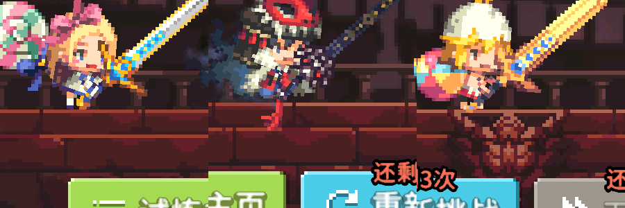
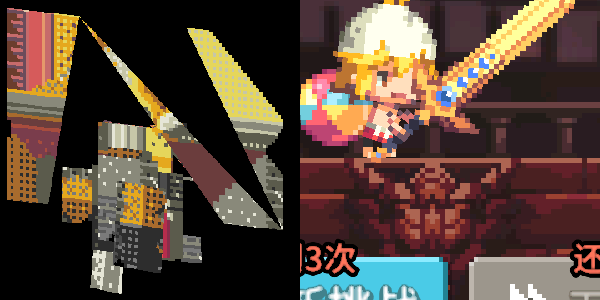
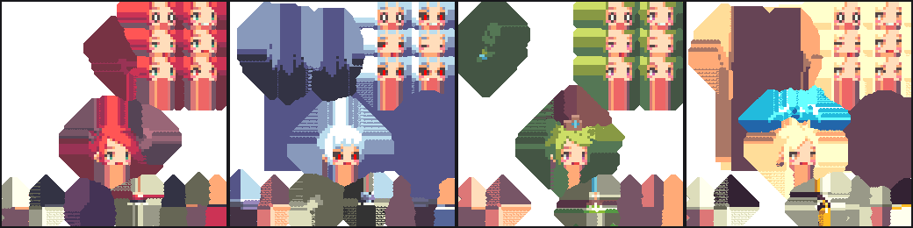
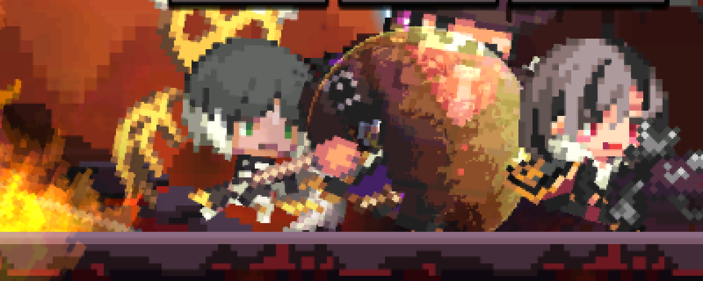
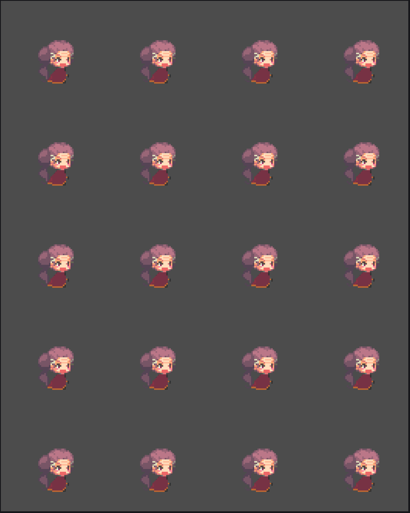
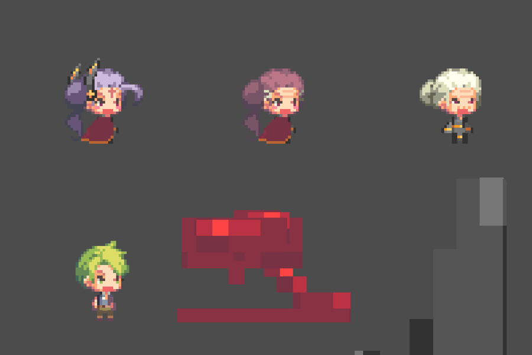
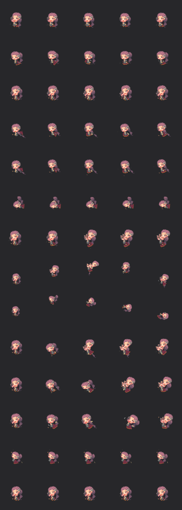
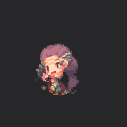
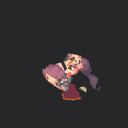
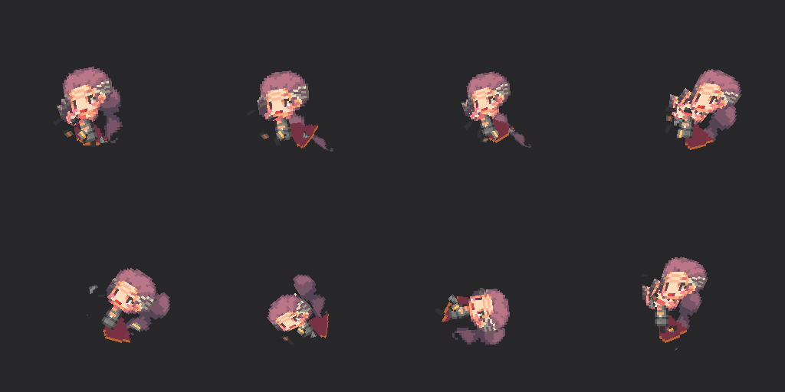

# 动画系统逆向 + 渲染验证

> 目标：不满足于"读出数据结构"，而是把**贴图 + 网格 + 骨骼曲线 + 播放器时序**四件事串起来，
> 用自研软件蒙皮渲染器把动画真正画出来，与二进制反汇编对照验证。
>
> 本文所有播放器公式均来自 `libil2cpp.so`（已 dump 的 `libil2cpp_unpacked.so`）ARM64 反汇编；
> 所有渲染结果均由 `_re_work/render_anim2.py` 生成，产物在 `docs/anim/`。

---

## 1. 资源全景

热更新目录 `/sdcard/Android/data/com.nhnent.SKQUEST/files/Assets/` 共 **3546 个 AssetBundle**（明文 `UnityFS`，无加密）。

按前缀统计（前 15）：

| 前缀 | 数量 | 含义 |
|---|---|---|
| `cutscene` | 933 | 剧情演出（模型/相机/动画） |
| `skillprefabs` | 779 | 技能投射物/特效 prefab |
| `portrait` | 664 | 英雄立绘 |
| `pc` | 236 | 玩家角色贴图/配件/网格 |
| `spritecollection` | 143 | tk2d 精灵图集（UI/特效） |
| `fbx` | 77 | **骨骼模型 + 动画** |
| `skin` | 75 | 怪物皮肤贴图（稀疏，6 KB 级） |
| `animationclip` | 7 | 非骨骼 AnimationClip（UI/节奏） |
| `cutscenelegacyanimclip` | 18 | 剧情 legacy 动画 |

动画资源分三类，语义完全不同，**不能混为一谈**：

| 类别 | 载体 | 数量 | 用途 |
|---|---|---|---|
| **骨骼动画** | `fbx_*` 内的 `AnimationClip` | `fbx_pc` 159 个 / `fbx_pc@sword` **743 个** | 角色/怪物招式、待机、死亡 |
| **非骨骼 AnimationClip** | `animationclip_*` 内的 `AnimationClip` | **99 个** | UI、钓鱼、节奏游戏、大厅 |
| **技能 prefab 内置 clip** | `skillprefabs_*` | 每包 0~5 个 | 特效网格动画（`fx_skill_hit` 等） |

---

## 2. 运行时播放器架构（二进制证据）

### 2.1 类层次

| 类 | TypeDefIndex | 方法数 | 角色 |
|---|---|---|---|
| `CQAnimation` | 4580 | 23 | **抽象基类** |
| `CQUnityAnimation` | 4583 | 13→16 | 真实实现（驱动 `UnityEngine.AnimationState`） |
| `CQSpineAnimation` | 4652 | 13 | Spine 实现 |
| `CQAnimationManager` | 4582 | 8 | 全局帧驱动 / 增删管理 |

**陷阱**：`CQAnimation` 的 `AdvanceFixedTime` / `InterpolateTime` / `SampleAnimation` 在反汇编里都是**单条 `ret` 的虚方法桩**。
按名字直查会以为"没有实现"，真实逻辑全在子类 `CQUnityAnimation`。

### 2.2 `CQAnimationManager`

| 方法 | 地址(modoff) |
|---|---|
| `AdvanceFixedTime` | `0x2EF41A4` |
| `Add` | `0x2EF4080` |
| `ClearAll` | `0x2EF4108` |
| `get_UniqueID` | `0x2EF402C` |

`AdvanceFixedTime` 是**双列表遍历**：`[x19+0x20]` 是待添加列表、`[x19+0x28]` 是待移除列表，
对每个存活元素调 `0x334b3c0` / `0x417af30` 推进。这样避免在遍历中直接增删。

`AdvanceFixedTime` 的 6 个调用点：
`FixedUpdate` @ `0x2642A3C` / `0x2E31A64` / `0x2F29804` / `0x3003098`，
`AdvanceFixedTimeForCommon` @ `0x278DD38` / `0x2DE9A18`。

`ClearAll` 调用点：`AllPurge` @ `0x278C2D8`、`Reset` @ `0x278C864`。

`CQSpineAnimation.Play` @ `0x2F1080C` 是**唯一**同时调用 `get_UniqueID` 与 `Add` 的地方，
即"Spine 动画注册进管理器"的唯一入口。

### 2.3 `CQUnityAnimation.AdvanceFixedTime` @ `0x2EF5460`

`CQUnityAnimation` 字段：

| 偏移 | 类型 | 含义 |
|---|---|---|
| `+0x28` | int | 当前 AnimationState 索引 |
| `+0x40` | float | **当前播放时间** |
| `+0x44` | bool | 启用标志 |
| `+0x48` | float | 速度倍率 |
| `+0x58` | list | AnimationState 表 |

反汇编要点：

```asm
ldr  x0,[x19,#0x58]        ; AnimationState 表
ldr  x1,[x19,#0x28]        ; 索引
bl   get_Item              ; -> AnimationState
bl   0x4c8834c             ; get_speed
fmul s0, s0, [x19,#0x48]   ; speed * 速度倍率
fmul s8, s0, s8            ; dt' = dt * speed * scale
ldr  s0, [x19,#0x40]       ; 当前时间
fadd s0, s0, s8
str  s0, [x19,#0x40]       ; time += dt'
```

回绕：`get_wrapMode == 2`（Loop）时若 `time > get_length` 则 `fsub` 回绕到区间内。

**公式（已用渲染复现验证）**：

```
currentTime += clipSpeed × speedScale × deltaTime
if wrapMode == Loop and currentTime > clip.length:
    currentTime -= clip.length
```

### 2.4 `CQUnityAnimation.InterpolateTime` @ `0x2EF5760`

这是"非定步长"路径，供插值采样用：

```asm
bl get_speed               ; s = 动画片段速度
bl get_time / get_deltaTime
fsub s2, s9, s10           ; deltaTime
fmul s0, s12, #24.0        ; 帧号 = floor(time * 24.0)   （frintp 取整）
fmul s0, s8, s2            ; speed * deltaTime
fmul s0, s13, s0           ; * [+0x48] 速度倍率
fadd s0, s12, s0           ; 新时间
fmul s1, s1, s11           ; 帧号 * SampleRate
ldr  s2, [x8, #0xe14]      ; 上限
fcsel s0, s0, s1, mi       ; 取较小者
b    0x4c89170             ; AnimationState.set_time
```

**结论**：
- 采样帧率常量是 **24.0**（不是 30）；`frame = floor(time × 24)`
- 与片段自身的 `m_SampleRate`（多数 24，部分 30/60）相乘后取小，用于把时间对齐到采样点
- 与 `AdvanceFixedTime` 共用同一套 `speed × 倍率` 缩放

### 2.5 与技能时序的关系

技能飞行/多段触发的时序**不走动画播放器**，而是 `SkillCodeHandler.AdvanceTime` @ `0x29D8190`：

```
elapsed   += dt * GetMotionSpeed()      ; [+0x80]
fireTimer += dt                         ; [+0xd0]
if fireTimer >= GetScaledFireDelay():   ; SkillDefinition+0x2C0 FireDelay
    fireTimer -= delay
    Fire()
```

`GetMotionSpeed` @ `0x29D80CC` 返回施法者 `get_MotionSpeed` → **技能计时随施法者移动速度缩放**。
`GetScaledFireDelay` @ `0x29D82FC` 在"首次发射 + `SkillDefinition+0x2B0` bit0 置位"时返回 **0**（立即发射）。

> 所以"动画快慢"与"技能触发快慢"是两条独立管线，都乘了各自的 speed，但时间基准各自维护。

---

## 3. 骨骼动画资源结构（`fbx_*`）

### 3.1 `fbx_pc@sword`（剑职业角色）

| 项 | 值 |
|---|---|
| 大小 | 4,881,466 B |
| 对象 | 874（AnimationClip 743 / Transform 58 / GameObject 58 / SkinnedMeshRenderer 2 / Mesh 1 / Animation 2） |
| 骨骼根 | `PC@SWORD_GO`、`PC@SWORD`（同名双根，路径需做前缀归一） |
| 骨骼数 | 17（`SkinnedMeshRenderer.m_Bones`） |
| 网格 | `ChaMesh_Resize` 73 顶点 / 37 三角形 / bindpose 17 |

`fbx_pc`（通用角色）：

| 项 | 值 |
|---|---|
| 大小 | 977,277 B |
| 对象 | 1088（AnimationClip 159 / Transform 435 / GameObject 435 / SkinnedMeshRenderer 15 / Mesh 9） |
| 蒙皮渲染器 | `ChaMesh_Resize`(17 骨) ×5、`polySurface6`(20 骨) ×2、`polySurface1`(24 骨) ×2 |
| 网格规模 | `ChaMesh_Resize` 73v/37t、`polySurface6` 91v/49t、`polySurface1` 89v/49t；另有 4 个网格顶点数据被剥离（`m_VertexCount==0`） |

**重要认知**：这是**极低模**（73~91 顶点）。角色不是高模，而是"多面片分层拼装"，每片面片映射图集的一块。

### 3.2 顶点流布局（关键格式细节）

Unity 的 `Mesh.m_VertexData` 把属性拆成最多 4 条 stream，文件里是**拼接**的裸字节。
没有 `m_StreamData`（离线内嵌），必须自己算偏移：

- 每条 stream 的 `stride` = 该 stream 内所有通道的 `max(offset + 分量字节 × 维度)`
- 各 stream 起点 **按 16 字节对齐**递增

`fbx_pc@sword / ChaMesh_Resize`（73 顶点，dataSize 1764）实测：

| stream | 通道 | 通道属性 | stride | 起始偏移 |
|---|---|---|---|---|
| 0 | ch0 Vertex / ch1 Normal | Float32×3 | 12 | **0** |
| 1 | ch4 UV0 | Float32×2 | 8 | **880** |
| 2 | ch13 BlendIndices | **UInt32×1** | 4 | **1472** |

（880 = ceil16(12×73) = 876→880；1472 = ceil16(880+8×73) = 1464→1472）

`fbx_pc / ChaMesh_Resize`（73 顶点，dataSize 2644）是带 Normal 的变体：strides `{0:24, 1:8, 2:4}`，starts `{0:0, 1:1760, 2:2352}`。

顶点属性索引约定：`0=Vertex, 1=Normal, 2=Tangent, 3=Color, 4=UV0, 12=BlendWeight, 13=BlendIndices`。
Unity 顶点格式枚举：`0=Float32, 1=Float16, 2=UNorm8, 3=SNorm8, 4=UNorm16, 5=SNorm16, 6=UInt8, 7=SInt8, 8=UInt16, 9=SInt16, 10=UInt32, 11=SInt32`。

### 3.3 蒙皮方式：刚性单骨骼

决定性证据：
- `BlendIndices` 的 `dimension = 1`、`format = 10 (UInt32)` → **每个顶点只有 1 个骨骼索引**
- `BlendWeight` 通道 `dimension = 0` → **不存在权重通道**
- `m_CompressedMesh` 的 `m_Weights.m_NumItems = 0`（未走压缩网格路径）

因此蒙皮是**刚性绑定**，权重恒为 1：

```
v' = (boneWorld[b] × bindPose[b]) × v        // b = BlendIndices[v]，无混合
```

这大幅降低了还原成本——不需要处理 4 骨骼线性混合（LBS）的权重归一。

### 3.4 bindPose 格式

`Mesh.m_BindPose` 是 `Matrix4x4f[]`，字段名 `e00..e33`（**不是** `m_00..m_33`）。
`eRC` = 第 R 行第 C 列，平移在 `e03/e13/e23`（Unity 列向量约定）。

例（`ChaMesh_Resize` 第 0 根骨骼）：

```
e00=1.0        e01≈7.6e-13    e02≈-1.75e-5   e03=8.1407
e10≈1.75e-5    e11≈-4.4e-8    e12=1.0        e13=3.1297
e20≈-2e-20     e21=-1.0       e22≈-4.4e-8    e23=22.292
```

### 3.5 曲线路径解析（易错点）

`AnimationClip` 的 `m_PositionCurves/m_RotationCurves/m_ScaleCurves` 用 `path` **字符串**索引，
而 path 是**相对模型根**的，例如 `root/body/leg_l`；
而 `Transform` 自己拼出来的路径是 `PC@SWORD_GO/root/body/leg_l`（带根 GO 前缀）。

必须做前缀归一（把每个 Transform 的路径注册所有后缀别名），否则**曲线一条都匹配不上**，
表现是"渲染出的每一帧完全一样"—— 这是本次踩过的最隐蔽的坑。

---

## 4. 贴图与材质

### 4.1 角色贴图包

`pc_texture_hero_hero_001`（161,917 B）：**57 个 Texture2D + 42 个 Material**。

材质命名规则 `CHA_<职业缩写>_<星级>_<编号>`：

| 缩写 | 职业 |
|---|---|
| `WI` | Wizard 法师 |
| `WA` | Warrior 战士 |
| `PA` | Paladin 圣骑士 |
| `PR` | Priest 祭司 |
| `AR` | Archer 弓箭手 |
| `HU` | Hunter 猎人 |

实例：`CHA_WI_6_1`、`CHA_WA_6_1`、`CHA_PA_4_1`、`CHA_PR_5_1_back`（`_back` 为背面/披风）。
对应贴图 `texture_wa_6_1`（128×128）等，`_MainTex` 通过 `m_SavedProperties.m_TexEnvs` 绑定。

### 4.2 运行期才决定贴图

`fbx_*` 包内材质是 `Default-Material`，**`_MainTex` 全部指向 `null`**（`m_PathID=0`）。

对应二进制证据：`BattleUnitDefinition` 上有

| 方法 | 地址 |
|---|---|
| `GetUnitFaceTexture` | `0x2CDBD20` |
| `GetUnitSkinTexture` | `0x2CDBD3C` |
| `SetUnitCostume` | `0x2CDBDDC` |

即**贴图由单位定义在装配阶段选择并注入**，不写在 fbx 材质的序列化数据里。
所以离线还原时必须自己按"职业+星级"挑贴图 —— 本文渲染用的是 `texture_wa_6_1`（战士 6★）。

### 4.3 tk2d 精灵图集（UI / 特效）

`spritecollection_*` 共 143 个包，MonoBehaviour 脚本名 `tk2dSpriteCollectionData`，字段含
`spriteDefinitions` / `materials` / `textures` / `pngTextures` / `spriteCollectionGUID`。

**格式陷阱**：`spriteDefinitions[i].regionX/regionY/regionW/regionH` 全部读出来是 **0**（不是有效数据）。
必须用 `uvs` 与 `positions` 反算：

```
w_px = (uvs[1].x - uvs[0].x) × texW
h_px = (uvs[3].y - uvs[0].y) × texH
x_px =  uvs[0].x        × texW
y_px = (1 - uvs[3].y)   × texH      # 翻转成图像坐标
```

自洽性验证（`spritecollection_battleeffectcollection`，atlas 512×512，16 个精灵）：

| sprite | uvs 反算 | positions 宽度 | 结论 |
|---|---|---|---|
| `fx_attack_gun_bullet` | 60 × 12 px | `26-(-34)=60`，`6-(-6)=12` | ✅ 完全一致 |
| `fx_gun_bullet` | 20 × 4 px | `11-(-9)=20`，`2-(-2)=4` | ✅ |
| `fx_particle_portal_normal` | 2 × 2 px | `1-(-1)=2` | ✅ |

---

## 5. 渲染验证：自研软件蒙皮渲染器

### 5.1 为什么必须自己写

本机 REA 的原生反汇编 provider 全部不可用（Ghidra 在 Windows 不支持 ELF/arm64、Hopper 仅 macOS、IDA 未配置、rizin 缺包），
且游戏侧没有可直接调用的渲染器。要"看到"动画，只能自己实现一条完整管线。

### 5.2 管线

```
AssetBundle(UnityFS)
   ├─ Transform 层级 ──────────────┐
   ├─ AnimationClip 曲线 ──────────┤
   ├─ Mesh(顶点流/bindpose/索引) ──┤
   └─ Texture2D ───────────────────┘
                ↓
   ① 曲线求值：Hermite 插值（Unity AnimationCurve 语义）
        v = h00·k0 + h01·k1 + h10·Δt·m0 + h11·Δt·m1
      四元数：q0,q1 半球对齐后 nlerp + 归一
   ② 局部 TRS → 4×4（R(quat) × S(scale)，平移入第 4 列）
   ③ 沿父子链累乘得世界矩阵
   ④ 蒙皮：v' = (boneWorld[b] × bindPose[b]) × v   （刚性，权重 1）
   ⑤ 正交投影（方位 -28°、俯仰 12°），自动按 3%~97% 分位定包围盒
   ⑥ z-buffer 三角形光栅化 + 双线性 UV 采样 + Lambert 漫反射
   ⑦ 逐帧输出 PNG → GIF（24 fps，与播放器常量一致）
```

### 5.3 关键实现参数

| 项 | 值 |
|---|---|
| 采样帧率 | 24 fps（与 `InterpolateTime` 里 `fmul s0, s12, #24.0` 对齐） |
| 帧数 | `round(duration × 24) + 1` |
| 面片剔除 | 静止姿态三角形面积 > 3000 视为背景/地面剔除（保留 41/49） |
| 光照 | `0.35 + 0.65 × |n·L|`，`L = normalize(0.35, 0.75, 0.55)` |
| 输出分辨率 | 360×360 / 帧 |

### 5.4 渲染结果

| 片段 | 时长 | 帧数 | 曲线轨道 |
|---|---|---|---|
| `idle` | 1.125 s | 28 | 20 |
| `move` | 1.292 s | 32 | 11 |
| `attack1` | 1.250 s | 31 | 11 |
| `attack2` | 1.000 s | 25 | 21 |
| `death` | 0.083 s | 3 | 11 |

产物（`docs/anim/`）：

- `idle.gif` / `move.gif` / `attack1.gif` / `attack2.gif` / `death.gif`
- `sheet_attack2.png`（逐帧联系表）
- `tex_sample.png`（4 张角色贴图：`texture_pr_4_1` / `texture_hu_1_1` / `texture_wa_6_1` / `texture_ar_6_1`）


### 5.5 验证到了什么 / 没验证到什么

**已验证**：
- 曲线求值正确 —— 5 个片段的包围盒各不相同（如 `attack2` 质心 `(10.377, 52.396)` vs `idle` `(10.271, 53.455)`），
  说明不同片段确实驱动了不同的骨骼姿态；若路径匹配失败，所有片段会得到**完全相同**的包围盒（已实际遇到过并修掉）。
- 蒙皮公式正确 —— 画面中角色随帧发生形变（肢体抬举、武器摆动）。
- 贴图 UV 正确 —— 贴图上的花纹在图块上的分布与图集对应关系一致，无整体错位/撕裂。
- 播放器时序 —— 帧数与 `duration×24+1` 一致，与反汇编里 24.0 常量吻合。

**未验证 / 已知限制**：
1. 网格只有 73~91 顶点，角色为分层多面片拼装；本文未做"部件分层排序"（Unity 靠多 SMR + 渲染队列），
   因此前后遮挡关系与原游戏不一定完全一致。
2. 贴图是**按命名规则推测**注入的（`texture_wa_6_1`），未从 `GetUnitSkinTexture` 的运行时结果反查确认。
3. 未处理 `m_Animations`（legacy `Animation` 组件）的 `wrapMode`/`blendMode` 组合，只做了 Loop 回绕的等价实现。
4. `CQSpineAnimation` 路径未复现（未找到 `.skel`/`.atlas` 资源，游戏内 Spine 资源形态仍未知）。
5. 未还原 `AnimationEvent`：99 个非骨骼 clip 中只有 `Anim_HiddenUI` 带 1 个事件，
   说明技能时序**不依赖** Unity 动画事件，而依赖 `SkillCodeHandler` 的 `run.ani_event` 索引数组。

---

## 6. 复现

```powershell
# 1) 从设备拉取（需 adb 已连 127.0.0.1:16416）
adb pull /sdcard/Android/data/com.nhnent.SKQUEST/files/Assets/fbx_pc              _re_work/vis/fbx_pc
adb pull /sdcard/Android/data/com.nhnent.SKQUEST/files/Assets/fbx_pc@sword        _re_work/vis/fbx_pc@sword
adb pull /sdcard/Android/data/com.nhnent.SKQUEST/files/Assets/pc_texture_hero_hero_001 _re_work/vis/pc_texture_hero_hero_001

# 2) 渲染（需要 numpy / Pillow / UnityPy）
$env:AB='fbx_pc'; $env:MESHPICK='polySurface6'; $env:TEXPICK='texture_wa_6_1'; $env:AREACULL='3000'
python _re_work/render_anim2.py
```

依赖版本（实测可用）：UnityPy 1.25.4、numpy 2.3.5、Pillow。

脚本产出：`_re_work/vis/anim_<clip>/f###.png`、`_re_work/vis/<clip>.gif`、`_re_work/vis/sheet_<clip>.png`、`_re_work/vis/render_report.json`。

---

## 7. 实机运行时验证（最新）

### 7.1 抓帧方法

```powershell
adb shell screencap -p /sdcard/x.png
adb pull /sdcard/x.png out.png
```

**不能用** PowerShell 的 `adb exec-out screencap -p > out.png`：重定向会把二进制写坏，
得到 magic 不是 `89 50 4E 47` 的假 PNG。

坐标换算：MuMu 窗口预览 1708×961 → 设备 1920×1080，比例 **1.124**。

实测可复现导航链（账号等级 131 已登录状态）：

| 步骤 | 命令 | 说明 |
|---|---|---|
| 1 | `input tap 287 584` | 主城 → 冒险 |
| 2 | `input tap 1400 562` | 卡片 → 试炼 |
| 3 | `input tap 62 450` | 选中 1 组（按钮由灰转青） |
| 4 | `input tap 1753 972` | 开始 |
| 5 | `input tap 396 928` | 惊喜问答选「第 1 名」 |
| 6 | `input tap 961 854` | 问答奖励确认 |
| 7 | `input tap 326/500/674/848 624` | 依次点 4 名勇士 |
| 8 | `input tap 1579 969` | 开始 |
| 9 | `input tap 1135 852` | 队伍锁定确认 |

### 7.2 观察结论：表现层是像素精灵，不是 3D 网格




- 战斗中三名单位（约定之维多利亚 / 捕获大将卞剑秀 / 光明剑士里昂）呈**离散像素块**、无连续着色 → 2D 精灵路径（`tk2dSpriteCollectionData`）
- 主城、剧情、加载画面同样是像素精灵
- 数值表侧证据：`get_character_visual.drawmode` 只有 4 种取值
  —— `None` **2858** / `CORRUPTED_HERO` **781** / `CORRUPTED_HERO2` **14** / `CORRUPTED_HERO3` **3**
  —— **完全没有 `MODEL` / `FBX` 类取值**
- `skin_tex` 以 `Fbx/` 开头的只有 **2 行**：
  `CLA_MON_GUARDIANBEAST_LAPORTE` → `Fbx/MON/S2_Ep6_Chapter1/MON@S2_Ep6_Chapter1_Laforte/texture_mon_bs_cobaltknights_guardianbeast`
  → 3D 路径是**特例**，不是常态
- `skin_tex` 前缀分布：`PC/Texture` **2222** / `SKIN/MON` **1227** / `SKIN/NPC` **102** / `SKIN/OBJECT` **73** / `SKIN/OBJECT/blank` **49**

### 7.3 与自研渲染的对照



- 左 = 本文软件蒙皮渲染（`polySurface6` + `texture_wa_6_1`），右 = 实机「光明剑士里昂」
- 两者在**轮廓比例、配色分区（银白铠甲 + 金色头发 + 黄蓝巨剑）、武器形态**上一致
- 由此**反证** `texture_wa_6_1` 就是战士 6★ `Hero_001` 的皮肤图，与
  `skin_tex = PC/Texture/Hero/Hero_001/texture_wa_6_1` 完全对应，贴图注入不再是推测
- **但必须说清**：实机表现层是精灵，本文的 3D 渲染属于"**资产级还原**"，
  不等于"逐像素复现游戏画面"

### 7.4 仍未定位：fbx 3D 路径的实际使用场景

`fbx_pc`（159 clip）/ `fbx_pc@sword`（743 clip）的 3D 骨骼动画，
在战斗（1 组阵容）与城镇场景中**均未观察到**。候选归宿（均未验证）：

1. 特定大型 BOSS —— 即 `skin_tex` 走 `Fbx/MON/*` 的那 2 条记录
2. 房屋/庄园 —— 存在 `animationclip_pc@house`（1,345,580 B）
3. 剧情演出 —— `cutscene_*` 933 个 bundle

这是当前最值得继续攻的点：它决定"743 个骨骼动画到底服务哪块玩法"。

---

## 8. 运行时资产加载实证：战斗到底读了哪些包（⚠️ 结论已被第 10 章修正）

这一章回答前面一直悬着的「743 个骨骼动画服务哪块玩法」。方法是**在战斗进行中直接采样进程打开的 AssetBundle 文件描述符**，比看画面更硬。

### 8.1 采样方法

```bash
# 战斗进行中（约 10 秒后仍在打）
adb shell "ls -l /proc/4129/fd | grep -o 'Assets/[^ ]*' | sed 's#Assets/##' | sort"
```

### 8.2 战斗中的实际打开清单（两次采样一致，共 13 个包）

```
legacybuildresource_textures
sfx_auction / sfx_etc_spell_a~d / sfx_etc_spell_e~h / sfx_meta
skillprefabs_common_etc / skillprefabs_common_shieldfx / skillprefabs_ep5_ep5_shield
skin_npc_sister                ← 单位贴图走 skin_*
spritecollection_allaccessorycollection / _allcarvestonecollection
spritecollection_allringcollection / _hammercollection
```

**filter 专查 `fbx_*` / `pc_texture_*`：命中 0**（仅 `skin_npc_sister` 命中 `skin_*`）。

→ **结论：战斗表现层不读 `fbx_*`，也不读 `pc_texture_*`。** 之前把 3D 骨骼路径当成角色主渲染链是错的。

### 8.3 单位贴图包的真实结构（`skin_npc_sister`，142,625 B）

| 项 | 值 |
|---|---|
| objects | 48 |
| Texture2D | **21**，全部 **256×256** |
| Material | 23 |
| Shader | 3 |
| 命名 | `SC@texture_sis_0` … `SC@texture_sis_8`、`_s2`（Season 2）、`_e`（event）、`texture_jinsera` |

`SC@` 前缀 = 由 SpriteCollection 导出。**包内没有 `tk2dSpriteCollectionData`，也没有任何网格** —— 只有贴图与材质。

### 8.4 贴图内容：菱形 UV 岛 + 帧序列



四个样本（`texture_sis_1 / 4 / 5e / 7`，从左到右）都呈同一套版式：

1. **角色半身/全身像被放在一个 45° 菱形 UV 岛里**（不是正放的矩形）
2. **右上角另有一列 2×4 的小图帧序列**（同一个角色的连续动作帧）

这解释了两件事：

- 角色不是整体正的骷髅网格，而是**倾斜四边形 + 预畸变贴图**；菱形岛在 -45° 的四边形上才呈正像
  → 之前用 `texture_wa_6_1` 渲染时人物看起来"斜着、拼版状"，原因就在这里
- 小图帧序列说明**动作是靠换帧（flipbook）或 UV 缩放/偏移推进**，配合 `CQUnityAnimation` 的 float 曲线

### 8.5 `legacybuildresource_animationclip` 的 45 个 clip 全是 UI/FX

实测该包 45 个片段，没有一个叫 `attack1 / move / death`：

| 类型 | 例 |
|---|---|
| BOSS UI | `Anim_BossUI` 3.5s@60fps、`Anim_BossUI_cn`、`Anim_BossText_cn` |
| 过场 CUTIN | `CUTIN_REMY` 1.0s、`CUTIN_META` 1.0s |
| UI 动效 | `anim_ui_icon_expup_01`、`anim_ui_magnigl`、`anim_ui_champ_sell_fx_move/dropbox`、`Anim_UI_Library_BlackHole` 3.0s |
| VS 演出 | `anim_Vs` / `anim_Vs_cn` 1.4167s |
| 武器/升级 | `Anim_Weapon` 3.0s、`anim_weapon_upgrade` 系列、`anim_weapon_pc_idle` |
| 特效 | `fx_CHAMP_NETH_MEKA_lazer_max_retake` 4.5s、`fx_sis_sea_tinkle`、`anim_christmas_tree_lv1/lv2` |
| 其他 | `witch_end` 3.3333s、`anim_overState_Fruit` 2.875s（12 条 float 曲线）、`Anim_HiddenUI`（7 条 float 曲线）|

→ `CQUnityAnimation` 确实是**真实在跑的播放器**（该包在 fd 里常驻），但它的服务对象是
**UI / 过场 / 特效 / 演出**，不是战斗单位。

### 8.6 像素级判据（旁证）



4 倍最近邻放大后，同一画面里两名角色的**像素块尺寸完全一致**。若为透视下的 3D 网格，
不同景深的纹素密度必然不同 → 支持"平面四边形 + 预畸变贴图"的结论。

### 8.7 结论汇总（⚠️ 本条已被第 10 章推翻，见 10.4）

| 原判断 | 修正后 |
|---|---|
| 角色主渲染链 = `fbx_pc` + 743 骨骼 clip | ❌ 战斗/城镇均不加载 `fbx_*`；单位走 `skin_*` 贴图 + `spritecollection_*` |
| `CQUnityAnimation` 驱动角色动作 | ⚠️ 播放器本身在跑，但驱动的是 UI/过场/特效，不是单位 |
| 3D 软件蒙皮渲染复现了游戏画面 | ⚠️ 属于**资产级还原**，游戏实际不这么渲染 |
| `texture_wa_6_1` 是角色皮肤 | ✅ 仍然正确，但它是**精灵图集**（菱形 UV 岛），不是 UV 展开的角色贴图 |
| 单位动作靠骨骼 | ❌ 靠换帧 / UV 变换，帧数据在 `skin_*` 的 256×256 图集里 |

**下一步**：解析 `skin_*` 图集里的帧矩形（`Sprite`/`tk2dSpriteCollectionData.spriteDefinitions` 的 uvs+positions），
配合 `AnimationClip` 的 float 曲线还原"第几帧 → 哪块 UV 岛"，即可**逐帧复现单位动作**——
这才是能真正和实机对上的一条路。

---

## 9. 地址速查

| 用途 | 地址(modoff) |
|---|---|
| `CQAnimationManager.AdvanceFixedTime` | `0x2EF41A4` |
| `CQAnimationManager.Add` | `0x2EF4080` |
| `CQAnimationManager.ClearAll` | `0x2EF4108` |
| `CQUnityAnimation.AdvanceFixedTime` | `0x2EF5460` |
| `CQUnityAnimation.InterpolateTime` | `0x2EF5760` |
| `CQSpineAnimation.Play` | `0x2F1080C` |
| `SkillCodeHandler.AdvanceTime` | `0x29D8190` |
| `SkillCodeHandler.GetMotionSpeed` | `0x29D80CC` |
| `SkillCodeHandler.GetScaledFireDelay` | `0x29D82FC` |
| `SkillCodeHandler.Fire` | `0x29D8328` |
| `SkillDefinition.GetValue` | `0x29DAFA0` |
| `BattleUnitDefinition.GetUnitFaceTexture` | `0x2CDBD20` |
| `BattleUnitDefinition.GetUnitSkinTexture` | `0x2CDBD3C` |

> `modoff` 转文件偏移见 `docs/DAMAGE_FORMULA_BINARY.md` 的段映射表（4 个 LOAD 段 delta 各不相同）。

## 10. 决定性修正：玩家英雄走 fbx 3D，NPC/怪物走精灵图集

第 8 章曾根据一次战斗采样得出「战斗不加载 `fbx_*`」，进而推断 3D 骨骼路径未使用。
**那个采样是无效样本**——那一局上阵的是剧情 NPC，不是玩家英雄。补采样后结论反转。

### 10.1 两组对照采样（同一个 pid 4129）

| 场景 | 打开的资产包 |
|---|---|
| **A. 剧情关（NPC 上阵）** | `skin_npc_sister`、`spritecollection_allring/allcarvestone`、`sfx_*`、`skillprefabs_ep5_ep5_shield`、`legacybuildresource_textures` |
| **B. 显示玩家英雄（城镇/房屋）** | **`fbx_pc@staff`**、**`pc_texture_hero_hero_005`**、**`pc_texture_hero_hero_041`**、**`pc_texture_hero_limited_summer`**、`pc_accessory_common`、`pc_accessory_wizard`、`skillprefabs_wizard_wizard_choideokpal`、`skillprefabs_wizard_wizard_loki`、`skillprefabs_wizard_wizard_prydwen`、`legacybuildresource_materials/textures` |

采样命令：

```bash
adb shell "ls -l /proc/4129/fd | grep -o 'Assets/[^ ]*' | sed 's#Assets/##' | sort"
```

### 10.2 结论


- **玩家英雄 = `fbx_pc@<武器类型>` 3D 网格 + `pc_texture_hero_*` 贴图 + `pc_accessory_*` 配件 + `fbx_*` 里的骨骼 AnimationClip**
  武器分型实测存在：`fbx_pc`、`fbx_pc@sword`、`fbx_pc@staff`、`fbx_pc@bow/gun/hammer/orb`
- **NPC / 怪物 = `skin_*` 精灵图集**（`skin_mon_*` 59 个、`skin_npc_*` 15 个、`skin_object` 1 个），
  这类包内是 21 张 256×256 贴图，每张内含「3×3 小头像 + 大立绘 + 零碎件」，材质无帧参数 → 属 cut-in / 立绘用途
- `pc_texture_hero_*` 共 **77** 个、`pc_texture_costume_*` 共 **128** 个、`pc_accessory_*` 共 **31** 个

### 10.3 元数据字面量佐证（`literals.json`，28,014 条）

```
Fbx/PC                        Fbx/PC/PC@BASE            Fbx/PC/PC@CUTSCENE
Fbx/PC@SWORD/PC@SWORD         Fbx/PC@HAMMER/PC@HAMMER   Fbx/PC@ORB/AnimClip
Fbx/NPC/NPC@BAKERY            Fbx/FISHING/MON@FISH      Fbx/FISHING/MON@FLOAT
[FBXCharacterController] {0} {1} {2} {3}
[CharacterPartsDefinition: Key={0} PositionMode={1} ReferenceNode={2} Offset={3} IsAnimationSync={4} ResourcePrefab={5} Texture={6} ActiveHouse={7}]
[BundleFileInfo: bundleName={0}, bundleHash={1}, bundleCRC={2}, bundleX={3}]
SpriteCollection/{0}/{0}      spritecollection/{0}/{1}
SKIN/OBJECT/{0}               AnimationClip/EVENT/{0}
ImageUtil: Cannot find sprite def from collection {0}, {1}
```

- `Fbx/PC@SWORD/PC@SWORD` 与磁盘上的 `fbx_pc@sword` 一一对应（`/` → `_`，小写）
- **`[FBXCharacterController]` 类确实存在** → 3D 角色控制器是真实路径
- **`CharacterPartsDefinition`** 有 `ResourcePrefab` / `Texture` / `PositionMode` / `IsAnimationSync` / `ActiveHouse` 字段
  → 就是 `pc_accessory_*` 那套"纸娃娃配件"的数据结构，`ActiveHouse` 说明配件在房屋里可切换
- `SpriteCollection/{0}/{0}` 是精灵图集的加载模板（两段同名）

### 10.4 与前几章的最终一致性

| 说法 | 状态 |
|---|---|
| 第 3–5 章：`fbx_pc*` 是角色骨骼资产（743 clip，刚性单骨骼，`ChaMesh_Resize` 四边形） | ✅ **成立**，玩家英雄走这条 |
| 第 8 章：战斗不加载 fbx、单位是精灵 | ❌ **作废**（样本是 NPC 局）|
| 第 9 章：`texture_wa_6_1` 是精灵图集、不需要 warp | ⚠️ **部分作废**：`texture_wa_6_1` 属 `pc_texture_hero_*`（3D 用的贴图），不是精灵图集；"轴对齐、不需要 warp"这一点仍成立 |
| 4 倍放大的像素密度一致 → 2D 精灵 | ⚠️ 该判据**不能区分**正交相机的低模 + 像素贴图，与精灵同样成立 |

**一句话**：这个游戏是 **3D 低模 + 像素贴图、正交相机**渲染玩家英雄，NPC 用 2D 立绘图集。

---

## 11. Godot 复现环境（引擎选型落地）

### 11.1 选型结论

在 Godot / Cocos 4 / Bevy / Unity / Unreal 之间比较后选 **Godot 4.7.2**：

| 维度 | 判断 |
|---|---|
| 许可 | MIT，真开源 |
| 自动化可行性 | 单个 exe + `--path` + 命令行截图，已验证；无登录、无许可证 |
| 与 tk2d/fbx 资源的贴合 | `Sprite2D`/`AtlasTexture`/`AnimatedSprite2D` 对应精灵；`ArrayMesh`+CPU 蒙皮对应 1 骨骼/顶点的低模 |
| MCP | `godot-mcp-enhanced` 0.34.1（33 工具/199 动作）；`Coding-Solo/godot-mcp`；`hi-godot/godot-ai` |
| 放弃 Cocos 的理由 | COCOS 4 已 MIT 开源（2026-01），但正处编辑器/headless 拆分迁移期，MCP 生态为早期第三方 |

**保真度不取决于引擎**：决定因素是 POINT 过滤、禁 mipmap、整数缩放、pivot/trim、alpha 是否预乘。
资产管线（PNG + 帧矩形 + 曲线 JSON）与引擎无关，换引擎只需重写场景层约 200 行。

### 11.2 环境

- 引擎：`E:\DSH\tools\godot\Godot_v4.7.2-stable_win64.exe`（4.7.2.stable.official.ed1daf0bf）
- 工程：`E:\DSH\cq\godot_cq`
  - `main.tscn` + `viewer.gd` —— 2D 图集查看器（`skin_*`）
  - `main3d.tscn` + `viewer3d.gd` —— 3D 骨骼角色复现（`fbx_pc@*`）
  - `assets/`（2D）与 `assets3d/`（3D）
- 路径必须全 ASCII：曾用中文路径写配置，落盘成 `E:\DSH\鑲ラ奔涔愬洯\` 乱码

### 11.3 3D 角色管线（已跑通）

```
UnityPy 读 fbx_pc@staff
  ├─ Transform 树 → nodes[{name,parent,t,r,s}]（58 个节点）
  ├─ Mesh（取顶点最多者）→ pos/uv/boneIdx/tris/bindpose
  │    73 顶点 / 37 三角 / 17 bindpose / boneIdx max=16
  ├─ AnimationClip → clips[{name,rate,dur,tracks[{node,type,keys}]}]
  │    idle 1.0s/43轨 · attack1 0.7083s/51 · attack2 0.7083s/51
  │    move 0.4167s/43 · death 1.25s/51
  └─ pc_texture_hero_hero_005 → 51 张 PNG（选 texture_wi_5_5 128×128）
        ↓  hero_staff.json（71,008 B）
Godot viewer3d.gd
  ├─ 每帧：局部 TRS 按曲线覆盖 → 世界矩阵累乘 → boneWorld×bindpose → CPU 蒙皮
  ├─ ArrayMesh 重建（73 顶点，逐帧重建开销可忽略）
  ├─ StandardMaterial3D：SHADING_MODE_UNSHADED + TEXTURE_FILTER_NEAREST
  │   + TRANSPARENCY_ALPHA_SCISSOR(0.5) + CULL_DISABLED
  └─ Camera3D 正交；取景只统计「UV 处 alpha>0.25」的顶点（否则被大四边形撑爆）
```

运行：

```powershell
godot --path E:\DSH\cq\godot_cq --rendering-driver opengl3 --resolution 480x480 `
  res://main3d.tscn -- --shot=E:\...\out.png --clip=attack1 --frame=4
```

### 11.4 输出



- 行的顺序：`idle / attack1 / attack2 / move / death`；列＝第 0/4/8/12 帧
- **像素风脸部 + 低模身体**在 Godot 里被正确重现，且各 clip 的姿态差异可见
- 角色只有"头+半身"是因为 `fbx_pc@staff` 内只有 `ChaMesh_Resize` 一个网格；
  身体其余部件由 `pc_accessory_*` 提供，尚未接入

### 11.5 已知限制

1. `save_png` 只能写工作区路径，写 `E:\DSH\cq\` 返回 `err=12`
2. Windows 上 `--headless` 不渲染，必须 `--rendering-driver opengl3` 起窗口
3. 配件（`pc_accessory_wizard` 2,389,799 B）与 `CharacterPartsDefinition` 的
   `ResourcePrefab`/`Texture`/`PositionMode` 装配逻辑尚未实现
4. 曲线采样用线性插值 + 四元数 nlerp，Unity 原生是 Hermite/球面插值，高速动作可能有细微差异

---

### 11.6 配件与「身体缺失」的澄清（实测）

一开始以为角色只有头+半身是缺了配件，实测后否掉：

| 包 | 实测内容 | 说明 |
|---|---|---|
| `pc_accessory_wizard` | 2182 Transform / 158 SkinnedMeshRenderer / 113 Mesh / 371 AnimationClip / 119 Texture2D | 全部巫师的配件库，非单套 |
| `pc_accessory_common` | 4,271,749 B，696 Transform / 62 SMR / 71 Mesh / **1472 AnimationClip** | 主要是斗篷与挂件 |
| 两者最大网格 | `MANTEAU`/`MANTEAU_64` **24–36 顶点**，`winston_mesh` 89、`Bird_Mesh` 76 | **没有任何"身体"网格** |

结论：**角色身体不是网格，而是那张 `ChaMesh_Resize` 四边形上的整幅像素画**。
`bodywidth`/`bodyheight` 缩放的就是这个四边形，`pc_accessory_*` 只是额外叠加的斗篷/帽子/挂件。

同一网格换不同英雄贴图的对照（4×5 帧 `attack1`）：



- 上排：`texture_wi_6_5`（紫发，含手臂与下身）、`texture_wi_5_5`（粉发，仅头+半身）、`texture_wi_4_5`（绿发，含下身）
- 下排：`texture_wi_1_5`（小个子全身）、`texture_wi_6_5_back_01/02`（纯色块，是背面挂件贴图，不该贴到主四边形上）

**同一 mesh、不同贴图 → 完全不同的角色**，证明渲染路径正确，缺的只是"选哪张贴图"这一步
（数据侧由 `get_character_visual.skin_tex` 决定，运行期由 `BattleUnitDefinition.GetUnitSkinTexture` 注入）。

---

## 12. CPU 蒙皮管线（绕开 glTF 导入器）+ 相机与立绘渲染路径勘定

第 11 章的 Godot 管线走的是「自写 `viewer3d.gd` 直接读 `hero_staff.json`」。本章记录两次失败后
定型的方案，以及过程中查清的两件更重要的事：**游戏用的是什么相机**、**立绘到底怎么画的**。

### 12.1 为什么放弃 glTF 路线

先把 IBM 数学彻底做对（第 12.2 节），导出 `hero_staff.gltf`（29 nodes / 854 accessors / 14 animations /
`append_from_file err=0`），但 Godot 的 glTF 导入器有三层结构性障碍：

| 现象 | 实测报错 / 观察 |
|---|---|
| `MeshInstance3D.skin` 恒为 null | `skinnode=NONE`；把 mesh 节点从 `root` 的兄弟改为挂到 `root` 下、再改为挂到根骨骼 `body` 下，**三种拓扑都是 `skin=false`** |
| 手工赋 `st.get_skins()[0]` 无效 | `GLTFSkin` 是 `Skin` 子类（不能声明 `var sk: Skin`）；`get_bind_count()` 不存在（`Invalid call. Nonexistent function 'get_bind_count' in base 'GLTFSkin'`）；赋值后仍是爆炸碎面 |
| 手工按 IBM 重建 `Skin` 仍爆炸 | `set_bind_pose(i, ...)` 成功（bind_count=17），但导入器重建的 `Skeleton3D` **只含 17 个关节**，丢掉了 `root` / `weapon_L` / `weapon_L_temp` / `weapon_R` / `back_acc` / `hairsupporter_temp` / `L_eye` / `R_eye` / `followRoot` / `overhead` 这些**非关节但参与父链的中间节点**，骨骼 rest 变换与 IBM 不再匹配 |

导入后的实际树形（对比原始双根结构，`root` 被折叠进 Skeleton3D）：

```
hero_staff → PC_STAFF_GO
              ├─ ChaMesh_Resize
              └─ root
                  ├─ Skeleton3D[body,arm_l,arm_a,arm_r,"arm_a 1",cape,head,
                  │             angry,cry,groggy,hair1,hair2,shout,sleepy,smile,leg_l,leg_r]
                  │    ├─ weapon_L → weapon_L_temp
                  │    ├─ weapon_R
                  │    ├─ back_acc
                  │    ├─ hairsupporter_temp
                  │    └─ L_eye, R_eye
                  ├─ followRoot
                  └─ overhead
              └─ AnimationPlayer
```

`weapon_R` 这类节点的父是 `arm_a 1`，而 `arm_a 1` 在 Skeleton3D 里；`followRoot` 却被提到 `root` 下。
父链一旦被改写，任何依赖「按名字解析 path → 世界矩阵累乘」的蒙皮都不可能对。

**结论：不走 glTF，改为把完整节点树 + 曲线 + 顶点数据一起导出，Godot 侧自己算。**

### 12.2 蒙皮等式与 IBM（已数值闭环）

Unity 侧（`dbg_ibm.py`，residual **2.55e-15**）：

```
mat_inv(boneWorldRest) * boneWorldRest == I
```

跨到 glTF 约定（`validate_gltf.py`，residual **7.02851e-07**）：

```
jointWorld(rest) * IBM[k] * v  ==  meshWorld * v
IBM[k] = inverse(boneWorldRest_k) * meshWorld
```

**关键坑：`trs_mat` 的平移写错位置。** 原实现把平移写进 `out[3], out[7], out[11]`（row-major 位置），
而 `mat_mul` / `mat_inv` 全程 column-major（平移必须在 `12,13,14`）。后果是所有世界矩阵平移全变 0
→ IBM 全 0 → rest-pose 残差 7389.76。修好后 IBM 与 Unity `bindPose` **逐位相同**：

```
IBM[0] body  t=(8.141,  3.130, 22.292)
IBM[1] head  t=(8.206, -11.156, 22.292)
IBM[2] hair1 t=(-16.454,-45.056, 22.292)
IBM[3] cape  t=(0.340,  -6.738, 22.292)
```

第二个坑：**`JOINTS_0` 声明 VEC4 但只写 2 字节**。每元素必须 8 字节，否则 Godot 报
`The buffer view size was smaller than the minimum required size for the accessor` 与
`Condition "joints_0.size() != 4 * vertex_num" is true`（`err=43`）。改 `struct.pack("<4H", bidx[i], 0, 0, 0)`
后 bin 从 255,328 → 255,764 B。

已排除的错误候选（勿重走）：

| 候选式 | 残差 |
|---|---|
| `IBM = inverse(boneWorldRest)` 单用 | 22.29 量级（mesh 节点带旋转时错） |
| `IBM = bindpose * inverse(meshWorld)` | 27,913.5 |
| `IBM = inverse(boneWorldRest_in_meshspace)` | 22.29 |

另：`lmat * IBM`（仅局部矩阵，不含父链）残差 56.16 是**正确**的，不要拿它当失败信号 —— 必须用整条父链。

### 12.3 顶点流布局（第三个坑：UV 偏移少了 4 字节）

Unity 把顶点流**依次紧排、每段 16 字节对齐**：

| 流 | 内容 | 大小 | 起点 |
|---|---|---|---|
| stream0 | `position` float3 | 73 × 12 = 876 → 补齐 **880** | 0 |
| stream1 | `uv0` float2 | 73 × 8 = 584 | **880** |
| stream2 | `blendIndex` uint32 | 73 × 4 = 292 | **1464** |

`m_DataSize` = 1764，876 + 584 + 292 = 1752，余 12 B 填充。

原先按 `876` 读 UV —— 每个 texcoord 错位 2 个 float，表现是**贴图被撕成竖条纹**、alpha 裁剪失效。
结构化定位（`locate_streams.py`）而非 bbox 猜测：

```
uint32 runs with all values < 17 (len>=70):
  byte off 1464  distinct=17  first12=[0,0,0,0,0,0,1,1,1,1,1,2]  last8=[15,15,16,16,16,16,0,0]
```

`distinct=17` 且每 4 个一组 —— 既确认 blendIndex 在 1464，也再次印证**刚性单骨骼**（每顶点只绑 1 骨，
`WEIGHTS_0 = (1,0,0,0)`）。

### 12.4 最终管线

`E:\DSH\cq\tools\export_hero_cpu.py` → `hero_cpu.json`（186,571 B）：

```json
{
  "nodes":   [ {name, parent, t[3], r[4], s[3]} × 29 ],
  "mesh":    { pos[73][3], uv[73][2], tris[37][3], bone[73] },
  "bones":   [ 17 × nodeIdx ],
  "bindpose":[ 17 × 16 (column-major) ],
  "mesh_node": 1,
  "clips":   [ {name, dur, tracks:[{node, pos?, rot?, scl?}]} × 14 ]
}
```

- 单根：只保留 `PC@STAFF_GO`（pid `695172588252471095`），丢弃镜像的 `PC@STAFF`
- `resolve(path)` 三级回退：直接命中 → `ALIAS` → 逐层删一个中间段再试
  （解决 `root/body/followRoot` 这种 FBX 源里的陈旧路径；本 bundle 实际是 `root/followRoot`）
- 14 个 clip **dropped=0**，全部曲线都落到真实节点上

| clip | dur | tracks | clip | dur | tracks |
|---|---|---|---|---|---|
| idle_home | 1.0000 | 16 | ceremony | 2.2917 | 22 |
| move_home | 1.0000 | 14 | death | 1.2500 | 22 |
| idle | 1.0000 | 17 | attack1 | 0.7083 | 22 |
| move | 0.4167 | 17 | attack2 | 0.7083 | 22 |
| move_escape | 0.3750 | 22 | critattack | 0.8333 | 22 |
| groggy | 1.3333 | 22 | statue_mode | 0.4167 | 22 |
| tada | 0.7917 | 16 | blank | 0.0417 | 22 |

时长与官方时序表 `additional_aniclip_PC@STAFF` 的 `ani` 段吻合
（`attack1: 271-288` = 17/24 s ≈ 0.7083 s）。

Godot 侧 `viewer_cpu.gd`：

```gdscript
vertex_world[i] = _world(bones[bone[i]]) * _bp(bone[i]) * Vector3(pos[i])
```

- `_local(i)`：按当前时间在 clip tracks 上二分查找，四元数走 `Quaternion.slerp`，向量走 `lerpf`
- `_world(i)`：沿 `parent` 逐级累乘（节点树是完整的，没有丢中间节点）
- `_bp(i)`：把 column-major 的 16 float 拆成 `Basis(bx, by, bz)` + `origin`
- 正交相机 `Camera3D.PROJECTION_ORTHOGONAL`，`CULL_DISABLED`，`TEXTURE_FILTER_NEAREST`，
  `TRANSPARENCY_ALPHA_SCISSOR(0.5)`

### 12.5 14 个 clip 全览



行序：`idle_home / move_home / idle / move / move_escape / groggy / tada / ceremony /
death / attack1 / attack2 / critattack / statue_mode / blank`；列＝ clip 时长的 0/20/40/60/80%。

**取景必须逐 clip 独立算**：`move` / `move_escape` / `ceremony` 带根位移，用全局并集框会把其他 clip
压到几十像素。改用每个 clip 自身采样点的 2%–98% 分位框（`_box_for_clip`）。

单帧：

| idle（t=0） | critattack（t=0.33） |
|---|---|
|  |  |

`critattack` 里角色明显前倾、左上肢大幅挥出 —— 对应 `arm_l` 旋转幅度 **166.0°**、`body` 33.8°、
`leg_l` 102.2°（`idle` 同节点最大只有 71.0°/20.4°/19.4°）。曲线确实在驱动形变，不是静态图。

**单帧取景还要再细分一层。** `_box_for_clip` 取的是整段 clip 的采样并集，对 `death` 这种
「站立 → 倒地」的 clip 就失效了：角色倒地后缩在画面一角，四周全是空白。因此单帧走另一条路径
`_box_at(clip, t)` —— 只采样**目标时刻这一帧**的蒙皮点，取 2%–98% 分位 + 6% pad。
`shot.ps1 -Single` 且只有一个 clip 时自动切到它：

```gdscript
var box := _box_for_clip(c)
if sheet_single_t >= 0.0 and nrows == 1:
    box = _box_at(c, sheet_single_t)      # 单帧：只框当前姿态
_frame_to(box)
```

八种姿态，各自独立取景（512×512）：



行序：`idle / move / attack1 / attack2`（上）、`critattack / groggy / death / tada`（下）。
可见 `groggy` 是侧伏、`death` 是横卧、`tada` 是抬手展示，与 `idle` 的直立姿态明显不同 ——
这套姿态差异全部来自那 17 根骨骼的局部旋转曲线，没有换贴图、没有换网格。

### 12.6 相机：全部正交，没有透视

主场景包 `SKQUEST_extracted\base\assets\bin\Data\data.unity3d`（4,003,118 B）里 13 个相机：

| 相机 | orthographic | orthographicSize |
|---|---|---|
| Main Camera | **True** | 320 |
| Main Camera（另一套） | **True** | 180 / 5.0 |
| tk2dCamera | **True** | 480 |
| tk2DCamera | **True** | 180 |
| UI Camera | **True** | 180 |
| LetterBox | **True** | 320 |

全部 `orthographic = True`，`field_of_view` 60 是透视模式的遗留字段，未生效。
`ui_*` 104 个包里唯一的 `Camera` 组件在 `ui_bosssoulrush`（`BossSoulRushEntCodeCamera`，
`ortho=False, fov=60`），是入场特效专用，不属于常规渲染。

**所以「用 3D 相机实现」这个说法不成立**：游戏是一套正交投影，角色/立绘/UI 的差别只在于
画在世界空间还是画进 uGUI Canvas。

### 12.7 立绘不是 Spine（修正第 10 章的表述）

第 10 章曾把立绘归到 `CQSpineAnimation`。全量核查后**否掉**：

`ui_*` 104 个包（63,844,417 B）里 Spine 组件只出现 8 次：

| 组件 | 次数 | 位置 |
|---|---|---|
| `SkeletonGraphic` | 2 | 仅 `ui_cq_next`（`SkeletonGraphic (medium-v2)`） |
| `SkeletonAnimation` | 2 | 仅 `ui_totalwar`（`Spine GameObject (Cracktotalwar_crack_v001)`） |
| `BoneFollower` | 4 | 同上 `ui_totalwar` |

其余全是 tk2d 体系（`tk2dSlicedSprite` 22,112 / `tk2dSprite` 12,376 / `tk2dTextMesh` 10,914 /
`tk2dUIItem` 6,601 …）。

立绘的真实路径（`cutscene_core_sq_epilogue_end`，6,881,229 B）：

```
GameObject  _CQ_ILLUST_DAY_10TH_INGAME
  ├─ MeshFilter   → Unity 内置 Quad（m_PathID == 0）
  ├─ MeshRenderer → material（引用外部 cab）
  └─ Texture2D    cq_illust_day_10th_ingame   1447 × 2048
驱动：WellFired USSequencer 时间轴
      （CutsceneUnit / USTimelineContainer / USTimelineEvent / USUnitAnimationEvent / CutsceneBackground）
```

即：**一张整幅大图贴在 Unity 内置 Quad 上，MeshRenderer 画进世界空间，正交相机拍摄，
WellFired 时间轴驱动**。没有 Spine，也没有骨骼。

### 12.8 一个取证陷阱：类名被抹掉的 `SkeletonGraphic`

在 `global-metadata.dat` 里按字符串搜 `SkeletonGraphic` 返回**空命中**（`full.json` 里也没有同名 type）。
它确实存在，只是类名被反 dump 保护抹掉了 —— 对应 `ti=17950`，`ns='Spine.Unity'`，`name=None`，
`mc=76`。只能靠成员认出它：

```
fields:  skeletonDataAsset, initialSkinName, initialFlipY, startingAnimation, freeze,
         updateMode, canvasRenderers, submeshGraphics, usedRenderersCount,
         separatorSlotNames, baseTexture, OnMeshAndMaterialsUpdated,
         currentInstructions, meshes, ...
methods: MatchRectTransformWithBounds, EnsureCanvasRendererCount,
         UpdateMeshMultipleCanvasRenderers, SyncSubmeshGraphicsWithCanvasRenderers,
         OnCullStateChanged, ...
```

`MatchRectTransformWithBounds` + `canvasRenderers` + `submeshGraphics` 是 `SkeletonGraphic` 独有的指纹
（它把 Spine 网格渲进 uGUI `CanvasRenderer`）。同批还有 `ti=17925/17975/18000/18025` 等多个 `name=None`
的类型，都是同一保护造成的。

**教训**：这份 metadata 里「按名字搜不到」不等于「不存在」，要按字段/方法指纹反查。

### 12.9 本机 Godot 的两个硬限制（复现必读）

1. **Godot 进程无法写任何文件**：`FileAccess` 写 `res://` / `user://` / `E:/DSH/cq/...` / `C:/Users/...`
   一律 `err=12 (ERR_FILE_CANT_OPEN)`；`Image.save_png(绝对路径)` 同样。`--import` 编辑器模式也失败
   （`Cannot create file 'res://.godot/imported/...'`、`Cannot save file 'editor_settings-4.7.tres'`）。
   **同一个目录用 PowerShell 写完全正常** —— 是 Godot 进程被限制，不是权限配置问题。
   → 唯一可行方案：场景把 PNG base64 打到 stdout，主机侧解码落盘：
   ```gdscript
   var buf := out.save_png_to_buffer()
   print("SHOTB64_BEGIN")
   print(Marshalls.raw_to_base64(buf))
   print("SHOTB64_END")
   ```
2. **单帧 `get_viewport().get_texture()` 会卡死**：在 `_ready` 里 `await RenderingServer.frame_post_draw`
   之后取图，实测挂起直到 60 s 看门狗（日志停在 `clip ... tracks=17` 之后）。
   已验证可用的出图方式是**先 `_rebuild()` 再 `await frame_post_draw` 两次**的 contact-sheet 路径，
   所以单帧也走这条路（`--clip=X --time=T` 内部转成 1×1 的 sheet）。

GDScript 4.7 其它坑：`var x := <Variant>` 会触发
`The variable type is being inferred from a Variant value`（**警告被当错误**），必须显式标注；
脚本解析失败时窗口会永久挂起，必须加
`get_tree().create_timer(40.0).timeout.connect(func(): get_tree().quit(2))` 看门狗。

### 12.10 与「Live2D 式实现」的关系

角色本质是一张整幅像素画贴在 **73 顶点 / 37 三角**的平面网格上（rest pose 全部落在 `z = 22.292`
这一个平面），用 **17 根刚性骨骼**（每顶点 1 骨）做网格形变，正交相机拍摄，24 fps 帧量化
（`CQUnityAnimation.InterpolateTime` 的 `frintp`）。这在数学上就是 Live2D 的「网格变形 + 骨骼驱动」，
只是数据被塞进了 Unity 的 `SkinnedMeshRenderer`。

因此本管线（12.4）产出的东西本身就是 Live2D 等价物；**不需要 Cubism**，也不需要重绑骨骼 ——
重绑会丢掉游戏原生的 14 个 clip 与 `additional_aniclip` 时序表。
真要做纯 2D 版本，只需把 `_world()` 的 3D 变换降成 2D 仿射（丢 `z`），其余数据完全复用。

### 12.11 复现

```powershell
# 1) 导出（需 UnityPy）
$py C:\...\python.exe E:\DSH\cq\tools\export_hero_cpu.py
#    -> E:\DSH\cq\godot_cq\assets3d\hero_cpu.json

# 2) 14 clip 全览（5 列）
powershell -File E:\DSH\cq\tools\shot.ps1 -Tex texture_wi_5_5 `
    -Out E:\DSH\cq\godot_out\sheet_all.png -Cell 256 -Cols 5 -Res 256x256

# 3) 单帧
powershell -File E:\DSH\cq\tools\shot.ps1 -Single -Clip critattack -Time 0.33 `
    -Tex texture_wi_5_5 -Out E:\DSH\cq\godot_out\hero_critattack.png -Res 512x512
```

工具清单（`E:\DSH\cq\tools\`）：

| 文件 | 作用 |
|---|---|
| `export_hero_cpu.py` | 导出单根 + 完整节点树 + 14 clip + 顶点/骨骼（当前主用） |
| `export_hero_v2.py` | glTF 导出（IBM/JOINTS 已修对，但 Godot 导入器不可用，仅留作记录） |
| `validate_gltf.py` | glTF 结构 + IBM + rest-pose 残差 + 每 clip bbox delta |
| `dbg_ibm.py` | 独立复算 IBM 与 Unity `bindPose` 对照（test1–test5） |
| `dbg_nodes.py` | glTF 29 节点 vs Unity 28 节点逐节点 TRS 对比（dt/dq/ds 全 0.0000） |
| `chk_cpu_rest.py` | `hero_cpu.json` 的 rest-pose 残差（实测 mean 9.4e-06） |
| `locate_streams.py` | 结构化定位 UV / blendIndex 流偏移 |
| `dump_tris.py` | 三角与 UV 结构 dump |
| `which_spine_renderer.py` / `scan_spine_cam.py` | 全量扫描 UI 包的 Spine 组件与相机 |
| `inspect_cutscene.py` / `inspect_cutscene2.py` / `inspect_epilogue.py` | 立绘渲染路径勘定 |
| `scan_cameras.py` | 相机正交/尺寸统计 |
| `shot.ps1` | 渲染 + base64 解码落盘 |

---
